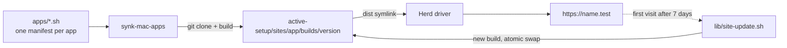

# dev-apps-setup

**Your open-source diagram tools, running on your own Mac. Set them up once, and
any Mac after that is one command away.**

[](https://github.com/hmzisb/dev-apps-setup/actions/workflows/lint.yml)
[](LICENSE)


You use Excalidraw, Mermaid, drawDB or ChartDB for real work. The hosted versions
are one tab away, but they're someone else's website: you paste your company's
database schema into a page you don't control, you click past promo banners, and if
it changes or goes down, your workflow does too. Self-hosting fixes that, but the
official route is Docker, a VM using memory all day just for a whiteboard. So you
build the apps yourself and lose an afternoon: an `.nvmrc` with the wrong Node
version, a package manager that new Node no longer ships, an install script that
rewrites your git config, tracking switches hidden in env files. It finally works,
and then you never update it. Months later you get a new Mac and have to work it all
out again, because none of it was written down.

**This repo is that afternoon, written down as code.** One command builds each app
from source, serves it at a stable address like `https://draw.test` through
[Laravel Herd](https://herd.laravel.com), and keeps it up to date by itself.

```bash
git clone https://github.com/hmzisb/dev-apps-setup.git ~/dev-apps-setup
~/dev-apps-setup/synk-mac-apps --setup
```

## 💡 Why not just reinstall when you need it?

Because installing isn't the hard part.

- 🧠 **Knowing how is the hard part.** Each app has its own build problems. Each
  one is solved once, in a short manifest with a comment that says why, so you
  never look it up again.
- 🔗 **Your diagrams belong to the address.** These apps save your work in the
  browser, separately for each domain. Reinstall on a new `localhost` port and your
  work seems gone. Here every app keeps the same domain, so your diagrams are where
  you left them, even after a reinstall.
- 🔁 **Builds you made by hand go stale.** Each app here builds its newest release
  once a week, the first time you open it. A failed build never takes the site down.
- 🔒 **Private work stays on your Mac.** Schemas, architecture sketches and internal
  flows stay local. No account, and no hosted copy you have to trust.
- 🪶 **No Docker, nothing in the background.** Herd serves plain files, and nothing
  runs until you open a tab. `https://draw.test` works from a bookmark, unlike a
  `localhost:5173` that only answers while a dev server is up. The exceptions are
  the two server apps, n8n and Mailpit, which run under PM2 only once Herd is running.
- 🧳 **A new Mac takes one command.** Re-running it is always safe: finished steps
  are skipped, and anything that drifted is repaired.

**Who it's for:** developers on a Mac, especially if you already use Laravel Herd,
who use browser-based diagram tools for real work, would rather not paste internal
schemas into a website, and don't want Docker running for a whiteboard.

## 📦 Apps

| App | Default URL | What it's for | Upstream license |
|---|---|---|---|
| [ChartDB](https://github.com/chartdb/chartdb) | `https://chartdb.test` | Database schema diagrams from a SQL query | AGPL-3.0 |
| [drawDB](https://github.com/drawdb-io/drawdb) | `https://drawdb.test` | Drag-and-drop database diagrams | AGPL-3.0 |
| [Excalidraw](https://github.com/excalidraw/excalidraw) | `https://draw.test` | Hand-drawn style whiteboard | MIT |
| [JSON Crack](https://github.com/AykutSarac/jsoncrack.com) | `https://jsoncrack.test` | JSON, YAML, CSV and XML as interactive graphs | Apache-2.0 |
| [Mailpit](https://github.com/axllent/mailpit) | `https://mailpit.test` | Catches mail from local apps (a server, see below) | MIT |
| [Mermaid Live Editor](https://github.com/mermaid-js/mermaid-live-editor) | `https://flow.test` | Diagrams from text | MIT |
| [n8n](https://github.com/n8n-io/n8n) | `https://n8n.test` | Workflow automation (a server, see below) | [Sustainable Use](https://docs.n8n.io/sustainable-use-license/) |

You pick which apps to install and choose each domain during setup. This repo has
no copy of their code. It downloads each app from its official repository when you
install it.

## 🚀 Getting started

**You need:** macOS (Apple Silicon or Intel) and an internet connection for builds.
The setup installs everything else after asking you first:

1. [Homebrew](https://brew.sh), [gum](https://github.com/charmbracelet/gum) (for the
   menus) and git.
2. Laravel Herd (free). Finish its first-run window, then turn on Node in
   **Herd > Settings > Node**.
3. The `synk-mac-apps` command, linked into Homebrew's `bin`.
4. Each app. For every app it asks whether to install it and on which domain.

You can clone the repo anywhere. The command finds its own folder.

## 🧰 Commands

```
synk-mac-apps --setup                          wizard: prerequisites, then add, move, update or remove apps
synk-mac-apps --status                         versions, last update, last check, HTTP status
synk-mac-apps --doctor                         check everything; exits 1 on a problem
synk-mac-apps --update [app|all]               check for and build new versions now
synk-mac-apps --install [app] [--domain name]  install, move or repair an app
synk-mac-apps --uninstall [app] [-y]           remove an app
synk-mac-apps --list                           apps this repo knows about
```

Examples:

```bash
synk-mac-apps --install excalidraw --domain whiteboard   # https://whiteboard.test
synk-mac-apps --update chartdb
synk-mac-apps --uninstall drawdb -y
```

## ⚙️ How it works



1. **Check.** The first page load after 7 days starts `lib/site-update.sh` in the
   background. It asks GitHub for the newest stable `vX.Y.Z` tag, or the newest
   commit on a branch.
2. **Build.** It builds that version into `builds/<version>` using the Node version
   the app needs, through Herd's nvm.
3. **Validate.** It rejects a build that has no `index.html`.
4. **Swap.** It points `dist` at the new build in one atomic step. Files from the
   previous build are carried over, so tabs that are already open keep working.
5. **Recover.** A failed or stuck run (30 minute limit) leaves the old build live
   and tries again the next day. Only one run per app happens at a time.

Each app's log is at `active-setup/sites/<app>/.auto-update/update.log`.

### Server apps (n8n, Mailpit)

n8n and Mailpit are servers, not sets of files, so they work differently:

- **Install.** n8n comes from npm and runs on Node 24 from Herd's nvm; Mailpit is one
  binary from its GitHub releases. Both go into `~/.synk-mac-apps/sites/<app>` and
  run under a PM2 of their own, separate from any PM2 you already use. Herd forwards
  `https://n8n.test` to port 5678 and `https://mailpit.test` to port 8025.
- **When they run.** A LaunchAgent starts them when Herd starts. Nothing starts them
  at boot: after a restart they come back only when Herd opens (right away if Herd
  opens at login). Quitting Herd doesn't stop them.
  - **n8n** keeps running until you shut down or restart the Mac.
  - **Mailpit** stops itself after an hour with no new mail and no inbox tab open,
    and starts again the next time Herd starts. To start it sooner, run
    `synk-mac-apps --install mailpit`. While it is stopped, apps that send mail get
    "connection refused".
- **Updates.** Only when you run `synk-mac-apps --update <app>`. A new version may
  change its database, so the update first saves a copy of it
  (`<database>.before-<version>`), keeps the previous version, and restarts the app.
- **Logs.** `~/.synk-mac-apps/sites/<app>/logs/<app>.log`, and
  `~/.synk-mac-apps/herd-start.log` for each start that Herd triggers.

To send your apps' mail to Mailpit, point them at SMTP `127.0.0.1:1025`. In Laravel's
`.env`: `MAIL_MAILER=smtp`, `MAIL_HOST=127.0.0.1`, `MAIL_PORT=1025`.

It lives in `~/.synk-mac-apps` rather than `active-setup/` because macOS blocks
background jobs from reading Desktop, Documents and Downloads, where you may have
cloned this repo.

<details>
<summary><b>Roll back to the previous version</b></summary>

The live build and the previous one are kept. Inside the app's site folder:

```bash
ln -sfn builds/<old-version> dist.tmp && mv -fh dist.tmp dist
```

The rollback lasts until the next check (a week, or `--update`), which builds the
newest version again.
</details>

## 💾 Your data

These apps save your work in the browser (IndexedDB and localStorage), separately
for each domain.

- **Keep the domain to keep your data.** After a domain change the app looks empty.
  Moving back to the old domain brings the data back.
- **Uninstalling** removes the build but not your data. Reinstall on the same domain
  to get it back.
- **Back up** with each app's export: ChartDB and drawDB export JSON or SQL,
  Excalidraw saves `.excalidraw` files, and in Mermaid you copy the diagram text.
  Clearing the browser's site data deletes your work.

Excalidraw's share links, libraries and live collaboration still use excalidraw.com's
free services. Its tracking and error reporting are turned off.
**JSON Crack** keeps what you paste only for the current tab (sessionStorage), so
save anything you need with **File > Export**. Its text editor downloads its code
from unpkg.com, but your data stays in the browser.

**n8n** keeps its workflows, credentials and the key that encrypts them in
`~/.synk-mac-apps/data/n8n/.n8n`, not in the browser. Uninstalling keeps that folder,
and a reinstall picks it up again. Back it up by copying the folder while n8n is
stopped, or with n8n's own export. Its telemetry and update checks are off.
**Mailpit** keeps caught mail (the newest 500) in `~/.synk-mac-apps/data/mailpit`.

## 🗂️ Layout

```
synk-mac-apps              the CLI
apps/<app>.sh              one manifest per app: what to clone, how to build it
lib/site-update.sh         builds and deploys a new version of one app
lib/LocalValetDriver.php   Herd driver shared by every app
lib/idle-exit.sh           stops an idle server app (Mailpit)
active-setup/              git-ignored; everything generated lives here
  sites/<app>/
    src/                   git clone of the app
    builds/<version>/      the live build and the previous one
    dist -> builds/...     what Herd serves
    domain                 the installed domain (without .test)
    .auto-update/          update.log, last-check, last-updated
~/.synk-mac-apps/          server apps (n8n, Mailpit), outside the repo
  sites/<app>/             builds/<version>, current -> builds/..., ecosystem.json, logs/
  data/<app>/              the app's data; an uninstall keeps it
  pm2/                     PM2's own home, separate from ~/.pm2
  idle-exit.sh             stops an app with IDLE set after that many quiet seconds
  herd-start.sh            run by ~/Library/LaunchAgents/com.synk-mac-apps.pm2.plist
```

## 🤝 Contributing

To add an app, write one short manifest file. [CONTRIBUTING.md](CONTRIBUTING.md)
explains how, both for static single-page apps and for servers that run under PM2.

Report a security problem privately, as described in [SECURITY.md](SECURITY.md).

## ⚖️ License

[CC0-1.0](LICENSE): this repo's own scripts and docs are in the public domain, so you
can use them for anything. Each app keeps its own upstream license (see the table).
This repo never redistributes their code; it builds them on your machine.
