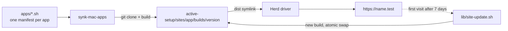

# dev-apps-setup

**Self-host open-source web tools on your Mac in one command.** No Docker, no
background daemons.

[](https://github.com/hmzisb/dev-apps-setup/actions/workflows/lint.yml)
[](LICENSE)


`synk-mac-apps` builds diagram and whiteboard apps from their source code and serves
them through [Laravel Herd](https://herd.laravel.com) at `https://<name>.test`. Each
app updates itself weekly. Clone this repo on a new Mac, run one command, and the
same setup is back.

```bash
git clone https://github.com/hmzisb/dev-apps-setup.git ~/dev-apps-setup
~/dev-apps-setup/synk-mac-apps --setup
```

## ✨ Why

- 🔒 **Private by default.** Your diagrams stay in your browser on your machine.
- 🪶 **Light.** Herd serves plain static files. Nothing runs in the background until
  you open a page.
- 🔁 **Always current.** Each app builds its newest release once a week, the
  first time you open it. A failed build never takes the site down.
- 🧳 **Portable.** One Git repo holds the whole setup. Recreating it on a new Mac
  takes one command.
- 🧯 **Safe to re-run.** Every command skips steps that are already done and repairs
  anything that drifted.

## 📦 Apps

| App | Default URL | What it's for | Upstream license |
|---|---|---|---|
| [ChartDB](https://github.com/chartdb/chartdb) | `https://chartdb.test` | Database schema diagrams from a SQL query | AGPL-3.0 |
| [drawDB](https://github.com/drawdb-io/drawdb) | `https://drawdb.test` | Drag-and-drop database diagrams | AGPL-3.0 |
| [Excalidraw](https://github.com/excalidraw/excalidraw) | `https://draw.test` | Hand-drawn style whiteboard | MIT |
| [Mermaid Live Editor](https://github.com/mermaid-js/mermaid-live-editor) | `https://flow.test` | Diagrams from text | MIT |

You pick which apps to install and choose each domain during setup. This repo has
no copy of their code. It downloads each app from its official repository when you
install it.

## 🚀 Getting started

**You need:** macOS (Apple Silicon or Intel) and an internet connection for builds.
The setup installs everything else after asking you first:

1. [Homebrew](https://brew.sh), [gum](https://github.com/charmbracelet/gum) (for the
   menus) and git.
2. Laravel Herd (free). Finish its first-run window, then turn on Node in
   **Herd > Settings > Node**.
3. The `synk-mac-apps` command, linked into Homebrew's `bin`.
4. Each app. For every app it asks whether to install it and on which domain.

You can clone the repo anywhere. The command finds its own folder.

## 🧰 Commands

```
synk-mac-apps --setup                          wizard: prerequisites, then add, move, update or remove apps
synk-mac-apps --status                         versions, last update, last check, HTTP status
synk-mac-apps --doctor                         check everything; exits 1 on a problem
synk-mac-apps --update [app|all]               check for and build new versions now
synk-mac-apps --install [app] [--domain name]  install, move or repair an app
synk-mac-apps --uninstall [app] [-y]           remove an app
synk-mac-apps --list                           apps this repo knows about
```

Examples:

```bash
synk-mac-apps --install excalidraw --domain whiteboard   # https://whiteboard.test
synk-mac-apps --update chartdb
synk-mac-apps --uninstall drawdb -y
```

## ⚙️ How it works



1. **Check.** The first page load after 7 days starts `lib/site-update.sh` in the
   background. It asks GitHub for the newest stable `vX.Y.Z` tag, or the newest
   commit on a branch.
2. **Build.** It builds that version into `builds/<version>` using the Node version
   the app needs, through Herd's nvm.
3. **Validate.** It rejects a build that has no `index.html`.
4. **Swap.** It points `dist` at the new build in one atomic step. Files from the
   previous build are carried over, so tabs that are already open keep working.
5. **Recover.** A failed or stuck run (30 minute limit) leaves the old build live
   and tries again the next day. Only one run per app happens at a time.

Each app's log is at `active-setup/sites/<app>/.auto-update/update.log`.

<details>
<summary><b>Roll back to the previous version</b></summary>

The live build and the previous one are kept. Inside the app's site folder:

```bash
ln -sfn builds/<old-version> dist.tmp && mv -fh dist.tmp dist
```

The rollback lasts until the next check (a week, or `--update`), which builds the
newest version again.
</details>

## 💾 Your data

These apps save your work in the browser (IndexedDB and localStorage), separately
for each domain.

- **Keep the domain to keep your data.** After a domain change the app looks empty.
  Moving back to the old domain brings the data back.
- **Uninstalling** removes the build but not your data. Reinstall on the same domain
  to get it back.
- **Back up** with each app's export: ChartDB and drawDB export JSON or SQL,
  Excalidraw saves `.excalidraw` files, and in Mermaid you copy the diagram text.
  Clearing the browser's site data deletes your work.

Excalidraw's share links, libraries and live collaboration still use excalidraw.com's
free services. Its tracking and error reporting are turned off.

## 🗂️ Layout

```
synk-mac-apps              the CLI
apps/<app>.sh              one manifest per app: what to clone, how to build it
lib/site-update.sh         builds and deploys a new version of one app
lib/LocalValetDriver.php   Herd driver shared by every app
active-setup/              git-ignored; everything generated lives here
  sites/<app>/
    src/                   git clone of the app
    builds/<version>/      the live build and the previous one
    dist -> builds/...     what Herd serves
    domain                 the installed domain (without .test)
    .auto-update/          update.log, last-check, last-updated
```

## 🤝 Contributing

To add an app, write one short manifest file. [CONTRIBUTING.md](CONTRIBUTING.md)
explains how. Only static single-page apps are supported for now. Support for apps
that run their own server (through PM2) is planned.

Report a security problem privately, as described in [SECURITY.md](SECURITY.md).

## ⚖️ License

[CC0-1.0](LICENSE): this repo's own scripts and docs are in the public domain, so you
can use them for anything. Each app keeps its own upstream license (see the table).
This repo never redistributes their code; it builds them on your machine.
